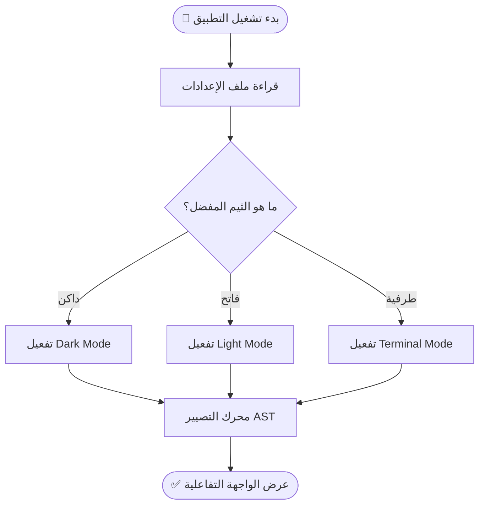
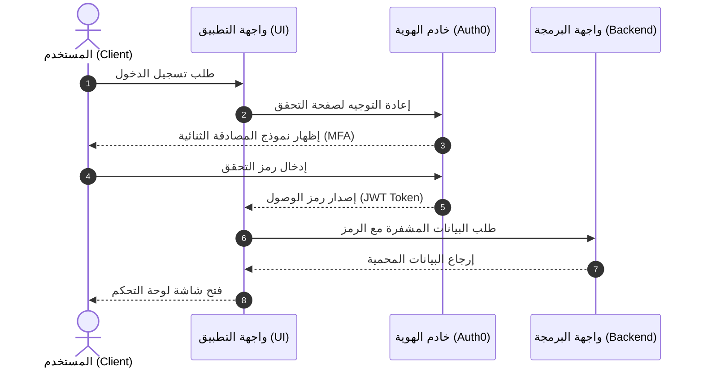
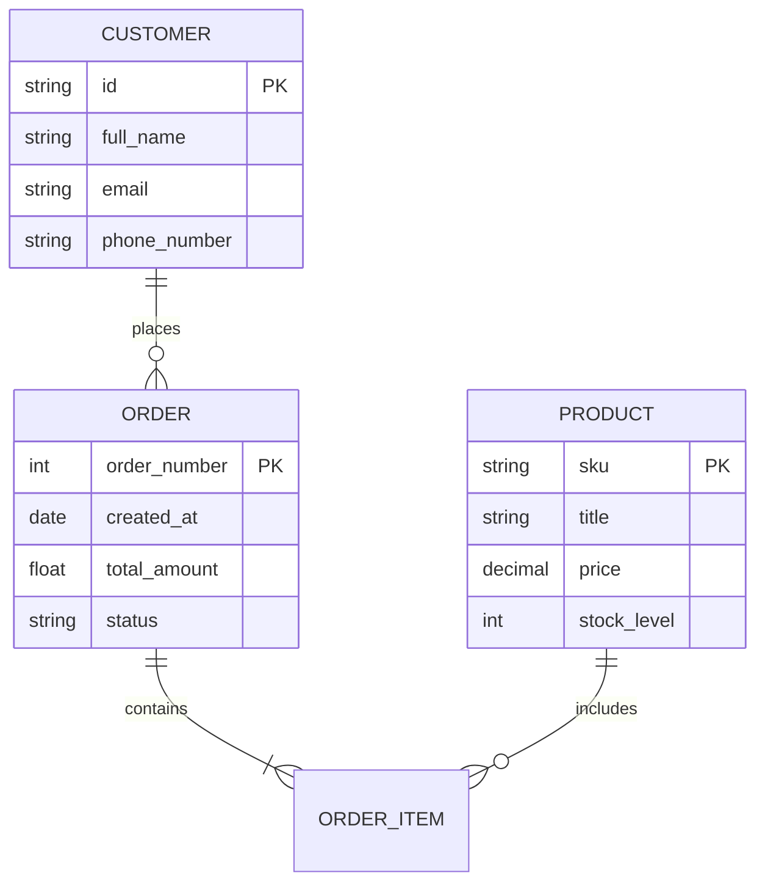
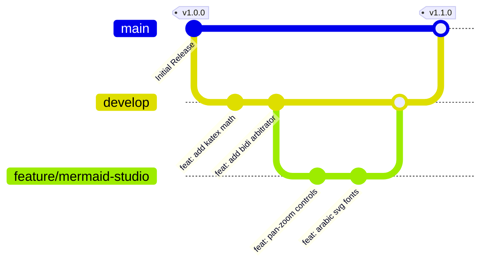
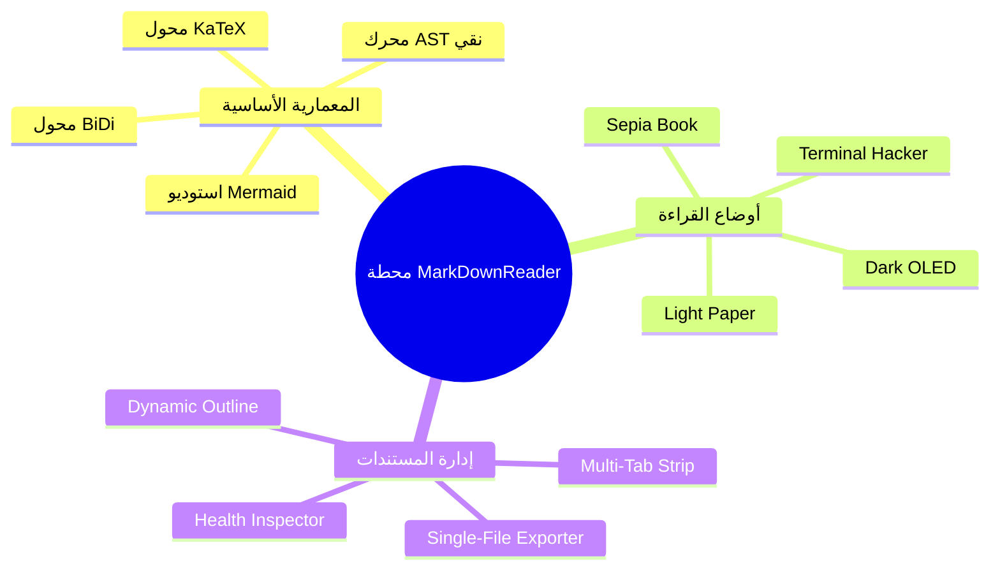
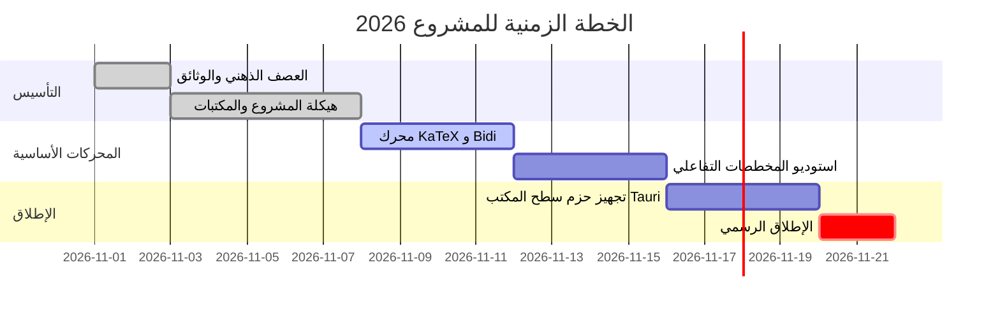

# محطة MarkDownReader: المختبر التقني والاستعراضي الشامل 🚀

مرحباً بك في الوثيقة المرجعية الشاملة المصممة لاختبار واستعراض **كافة إمكانات لغة التوصيف الماركداون (Markdown)** دون أي استثناء. تجمع هذه الوثيقة بين **النصوص ثنائية الاتجاه (العربية والإنجليزية)**، و**المعادلات الرياضية والكيميائية المتقدمة**، و**المخططات البيانية التفاعلية الكاملة**، و**الجداول المعيارية**، و**التنبيهات الرسمية**.

> [!TIP]
> **نصيحة للعروض التقديمية:** يمكنك تحويل هذا المستند فوراً إلى **عرض شرائح تفاعلي (Executive Slide Deck)** بمجرد النقر على زر **"عرض شرائح"** في الشريط العلوي، أو بالضغط على اختصار لوحة المفاتيح <kbd>Ctrl</kbd> + <kbd>P</kbd>.

---

## 1. التوجيه الذكي للنصوص العربية وعزل المصطلحات (BiDi & Punctuation Lock) 🌐

يعالج هذا القسم المعضلة الأزلية في محررات الماركداون التقليدية: **خلط الأوامر البرمجية والمسارات والكلمات اللاتينية داخل فقرات اللغة العربية**:

عند كتابة أوامر سطر الأوامر مثل `git checkout -b feature/auth-system` أو تشغيل الخادم عبر `pnpm run dev --host 0.0.0.0`، يجب أن تظل الفقرة متسقة من اليمين لليسار، وتستقر علامات الترقيم (كالأقواس والنقاط والفواصل) في موضعها الصحيح تماماً بنهاية السطر.

> [!NOTE]
> يقوم محرك **BiDi Arbitrator** بعزل كتل الأكواد والرياضيات تلقائياً داخل وسوم `<bdi dir="ltr">` لمنع حدوث أي تشوه أو انعكاس في اتجاه الحروف وعلامات الترقيم.

### قائمة التنبيهات المعتمدة (GitHub Alerts Spectrum):

> [!NOTE]
> **ملاحظة تشغيلية:** يدعم النظام التخزين المؤقت الداخلي للمستندات لضمان التبديل الفوري بين التبويبات بدون أي تأخير.

> [!TIP]
> **نصيحة للأداء:** احرص على استخدام المتغيرات المحلية داخل الدوال لتفادي حجز الذاكرة غير الضروري.

> [!IMPORTANT]
> **شرط إلزامي:** يجب ألا يتجاوز أي ملف مصدري في المشروع 400 سطر لضمان قابلية الصيانة والمعيارية الصارمة.

> [!WARNING]
> **تحذير أمني:** لا تقم بتخزين مفاتيح الـ API أو أسرار الاعتماد المشفرة داخل ملفات الماركداون العامة.

> [!CAUTION]
> **تنبيه خطر:** حذف مجلد `.git` أو تنفيذ أمر `rm -rf /` يؤدي لفقدان دائم للبيانات دون إمكانية للاسترجاع.

---

## 2. الموسوعة الرياضية والعلمية الشاملة ($\LaTeX$ / KaTeX Showcase) 📐

يدعم القارئ تصيير المعادلات الرياضية والفيزيائية والكيميائية بدقة بصرية فائقة sub-millisecond مع دعم الرموز المضمنة والمنفصلة:

### أ. المعادلات الرياضية المضمنة (Inline Math):
* معادلة تكافؤ الكتلة والطاقة لأينشتاين: $E = mc^2$
* نظرية فيثاغورس للمثلثات القائمة: $a^2 + b^2 = c^2$
* الانحراف المعياري للإحصاء الوصفي: $\sigma = \sqrt{\frac{1}{N}\sum_{i=1}^N (x_i - \mu)^2}$
* صيغة أويلر الشهيرة: $e^{i\pi} + 1 = 0$

### ب. المعادلات التفاضلية وحساب التكامل (Calculus & Integrals):
تكامل فورييه ثنائي الاتجاه للتحليل الطيفي للإشارات:

$$
\hat{f}(\xi) = \int_{-\infty}^{\infty} f(x)\,e^{-2\pi i x \xi}\,dx
$$

قانون غاوس الكهرومغناطيسي ضمن معادلات ماكسويل التفاضلية:

$$
\nabla \cdot \mathbf{E} = \frac{\rho}{\varepsilon_0}, \quad \nabla \times \mathbf{B} = \mu_0 \left(\mathbf{J} + \varepsilon_0 \frac{\partial \mathbf{E}}{\partial t}\right)
$$

معادلة شرودنغر الموجية لميكانيكا الكم:

$$
i\hbar \frac{\partial}{\partial t} \Psi(\mathbf{r}, t) = \left[ -\frac{\hbar^2}{2m} \nabla^2 + V(\mathbf{r}, t) \right] \Psi(\mathbf{r}, t)
$$

### ج. الجبر الخطي والمصفوفات المعقدة (Linear Algebra & Matrices):
مصفوفة دوران هندسية وحساب المحددات الذاتية:

$$
\mathbf{R}(\theta) = \begin{pmatrix}
\cos\theta & -\sin\theta & 0 \\
\sin\theta & \cos\theta & 0 \\
0 & 0 & 1
\end{pmatrix}, \quad \det(\mathbf{A} - \lambda \mathbf{I}) = 0
$$

### د. المعادلات الكيميائية الحيوية (Biochemical & Stoichiometry):
معادلة البناء الضوئي الخلوي باستخدام تدوين `mhchem`:

$$
\ce{6CO2 + 6H2O ->[ضوء الشمس][كلوروفيل] C6H12O6 + 6O2}
$$

تفاعل أكسدة واختزال أيوني:

$$
\ce{2MnO4- + 5H2O2 + 6H+ -> 2Mn^2+ + 5O2 ^ + 8H2O}
$$

### هـ. المتغيرات الفيزيائية المكتوبة باللغة العربية:
يدعم المحرك تسمية المتغيرات العربية الصريحة داخل المعادلات دون أي خطأ في التصيير:

$$
\text{طاقة الحركة} = \frac{1}{2} \times \text{الكتلة} \times (\text{السرعة})^2
$$

$$
\text{القوة} = \text{الكتلة} \times \text{التسارع}
$$

---

## 3. استوديو المخططات التفاعلي الشامل (Mermaid Studio Spectrum) 📊

يدعم البرنامج كافة أنواع مخططات `Mermaid` مع إمكانية التكبير ($+$)، التصغير ($-$)، إعادة الضبط ($↺$)، وحفظ المخطط كصورة `SVG` متجهة.

### أ. مخطط التدفق واتخاذ القرار (Flowchart with Arabic Nodes):


### ب. مخطط التعاقب الزمني للعمليات (Sequence Diagram):
يوضح دورة مصادقة الـ OAuth2 وتبادل الرموز المميزة:



### ج. مخطط العلاقات البيانية لقواعد البيانات (Entity-Relationship ER):


### د. شجرة الفروع وتاريخ الإصدارات (Git Graph):


### هـ. الخريطة الذهنية المعمارية (Mindmap):


### و. خطة المهام الزمنية (Gantt Milestone Roadmap):


---

## 4. جداول المقارنة الفنية ومعايير الأداء (Benchmarking Tables) 📊

| المؤشر التقني | برامج الإلكترون (Obsidian / MarkText) | محررات الويب التقليدية | محطة MarkDownReader الفائقة |
| :--- | :---: | :---: | :---: |
| **استهلاك الذاكرة (RAM Idle)** | 250MB - 450MB | 180MB - 300MB | **35MB - 55MB فقط** |
| **حجم الملف التنفيذي** | 120MB - 200MB | غير متاح أوفلاين | **أقل من 20MB** |
| **دعم RTL المضمن للأكواد** | ضعيف ويشوه الترقيم | جزئي | **عزل تام مع Punctuation Lock** |
| **تصدير HTML بدون إنترنت** | يحتاج Pandoc خارجي | غير متوفر | **ملف واحد مدمج بنقرة زر** |
| **وضع الطرفية (Terminal)** | يتطلب CSS Hacks | غير مدعوم | **مدمج مع توهج فوسفوري و Scanlines** |

---

## 5. نماذج الشيفرات البرمجية متعددة اللغات (Code Blocks) 💻

### شيفرة Rust (محرك معالجة الملفات عالي الأداء):
```rust
use std::fs::File;
use std::io::{self, Read};

pub fn read_markdown_document(path: &str) -> io::Result<String> {
    let mut file = File::open(path)?;
    let mut content = String::new();
    file.read_to_string(&mut content)?;
    println!("Successfully loaded {} bytes from {}", content.len(), path);
    Ok(content)
}
```

### شيفرة TypeScript (محول التوجيه الذكي BiDi Arbitrator):
```typescript
export class BiDiArbitrator {
  private static readonly ARABIC_REGEX = /[\u0600-\u06FF\u0750-\u077F]/g;

  public static detectDirection(text: string): 'rtl' | 'ltr' {
    const arabicMatches = text.match(this.ARABIC_REGEX);
    const count = arabicMatches ? arabicMatches.length : 0;
    return count / text.length >= 0.3 ? 'rtl' : 'ltr';
  }
}
```

### شيفرة استعلامات SQL (تحليل إحصائيات المستندات):
```sql
SELECT 
    d.document_id,
    d.title,
    COUNT(h.heading_id) AS total_headings,
    SUM(m.math_blocks_count) AS total_formulas,
    d.created_at
FROM documents d
LEFT JOIN headings h ON d.document_id = h.document_id
LEFT JOIN metrics m ON d.document_id = m.document_id
WHERE d.status = 'ACTIVE'
GROUP BY d.document_id, d.title, d.created_at
ORDER BY total_formulas DESC;
```

---

## 6. قائمة المهام التفاعلية والعناصر الموسعة (Checklists & Extensions) 📑

### حالة الإنجاز المعماري:
- [x] دعم التبويبات المتعددة المتزامنة (Multi-Tab Workspace)
- [x] محرك المعادلات الرياضية KaTeX مع الدعم الكامل لـ mhchem
- [x] التوجيه الذكي للنصوص العربية ومنع ارتباك الأقواس وعلامات الترقيم
- [x] أربعة أوضاع قراءة مميزة (Dark, Light, Sepia, Terminal)
- [x] استوديو مخططات Mermaid التفاعلي مع دعم الحروف العربية والـ Pan-Zoom
- [x] وضع العرض التقديمي الفوري بنقرة زر واحدة (Slide Deck Mode)
- [x] فاحص صحة المستند التلقائي وحساب الكلمات ومعدل القراءة
- [x] التصدير المستقل لملف HTML شامل بدون إنترنت

### عناصر التنسيق المتقدمة:
* **النصوص المحذوفة:** ~~هذه ميزة ملغاة من الإصدار السابق~~ وتم استبدالها بمحرك أسرع.
* **الرموز الكيميائية:** جزيء الماء $\text{H}_2\text{O}$ وغاز الميثان $\text{CH}_4$.
* **الهوامش السفلية:** تدعم المحطة الإحالات المرجعية التلقائية للمصادر الأكاديمية[^1].
* **الأقسام المطوية القابلة للتوسيع:**

<details>
<summary>🔍 اضغط هنا لعرض تفاصيل الإعدادات المتقدمة والتراخيص</summary>

هذا القسم يستخدم وسوم `<details>` و `<summary>` القياسية المدعومة بنسبة 100% في المحطة مع تأثير حركة ناعم يتناسب مع وضع القراءة المختار.
</details>

[^1]: توثيق رسمي لمعايير CommonMark 0.31 و GitHub Flavored Markdown المعتمدة في هذا النظام.
